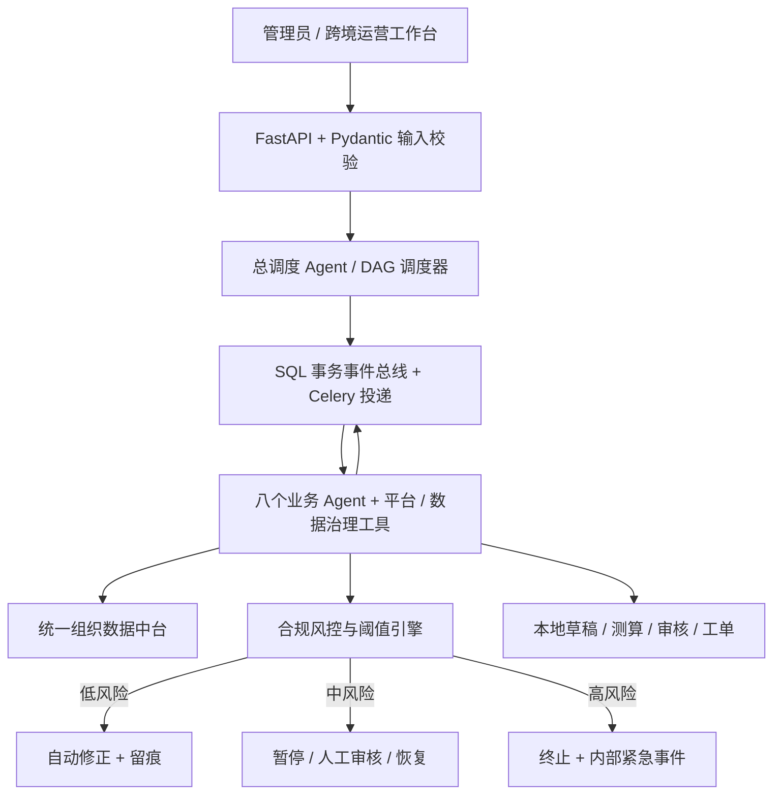
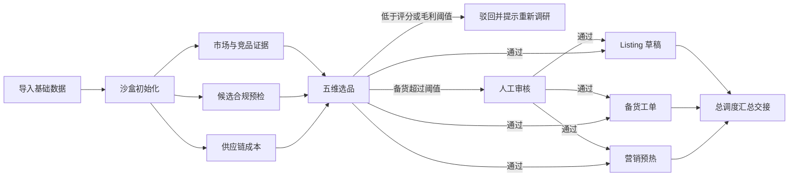

# EcomOps-MultiAgent：实现、验收与接入边界

2026-10-15。此需求覆盖此前“只保留抖店、智能体只读”的产品范围限制。沿用 FastAPI、Pydantic、SQLAlchemy 2、Alembic、Celery、Vue 3、Pinia 与 Vue Query，不引入第二套任务执行框架。旧国内业务页与 `/agent` 只读复盘保持原有合同，新跨境链路进入 `/ecomops`。

## 当前交付

这是**可运行的跨境运营核心与沙盒闭环**，尚不是五个平台可上线的全自动运营系统。所有跨境平台连接器状态均为 `adapter_required`；当前新建流程只包含能产出本地业务结果的步骤，不创建尚未实现的上架、投放、报名、退款或发货节点；不会返回虚构的商品 ID 或执行成功。旧任务的外部动作仍受 `waiting_integration` 门禁约束。

| 需求 | 已实现 | 尚需接入或完善 |
| --- | --- | --- |
| 初始化 | 连通性能力报告、数据门禁、角色与权限阈值输出、五维示例规则库 | 五平台官方 OAuth、资质与关联风险核验、六类双向同步、心跳与限流重连 |
| 数据中台 | 组织隔离的产品/供应商/用户/竞品/订单/指标/术语记录；批量校验、SKU 规范化、唯一键去重、来源与演示标记 | 平台自动采集、复杂异构映射、外部实时汇率及术语翻译应用 |
| 智能体编排 | 9 个核心角色 + 平台对接/数据治理；7 种 DAG 工作流；串行依赖、并行就绪节点、条件驳回、持久化事件 | 生产 Worker 并发压测、跨任务资源冲突仲裁、细粒度资源配额 |
| 市场与选品 | 导入竞品对标、五维等权评分、完整 landed cost、保本价、毛利与 ROI、备货金额复核、三个分支工单 | 实时趋势/热搜/社媒数据源、外部供应商报价校验、低分后的自动重新调研 |
| Listing | 文案模板、目标语言、关键词、可选真实模型草稿、规则清洗、强制人工版权与合规审核 | 平台图片规范自动适配、版权/专利数据库、上架接口、在线质量评分与自动 A/B 迭代 |
| 营销 | 预算分配草案、预算变动强制审核、输入消耗快照超预算时终止本地任务并告警、可选模型策略 | SP/SB/SD 广告与活动接口、实时竞价/否词/渠道归因、社媒发布和达人邀约 |
| 客服 | 意图/订单存在性检查、中文回复模板、可选目标语言模型稿、退款阈值审批、反馈工单 | 多渠道实时收信、时区工作时间调度、真实回复/退款/退货接口 |
| 履约 | 订单完整性与库存检查、人工贸易审核、仓储指令草案、补货公式、库存营销建议、物流异常工单 | 地址可投递性校验、真实库存事务预占/扣减、WMS/物流面单、自动物流追踪和赔付 |
| 数据复盘 | USD 指标聚合、GMV/毛利/客单价/复购/退款/转化/ROAS/净 ROI；证据诊断、策略交接 | 平台数据实时汇总、时间序列/归因根因分析；新跨境报告文件导出（旧报表页仍可用） |
| 风控与人工接管 | 低风险修正文案、中风险暂停、高风险终止；四类强制复核；接管/恢复/取消/优先级；审计 | 完整分站点法规与知识产权名录、外部紧急告警渠道、生产身份认证与细粒度 RBAC |
| 持续优化 | 计划启停与幂等触发、30 天完成率/执行耗时、规则乐观锁版本 | 成本节约/准确率标注基线、完整历史规则版本库、真实微调与模型发布 |

## 四层架构与消息总线



- `ecom_configurations`：当前组织规则及递增版本。更新带预期版本，过期写入返回 409。
- `ecom_records`：各业务角色共同读取的标准记录；组织/类型/编码唯一。
- `ecom_runs`、`ecom_tasks`：任务状态、依赖、输入、结果、重试计数、审批版本。
- `ecom_events`：与任务变化在同一数据库事务提交的消息；提交后由 Celery 投递。重复交付通过步骤状态的条件更新去重。
- `ecom_audits`：创建、导入、规则修改、审核、驳回、接管、恢复、取消、优先级和计划操作。
- `ecom_schedules`：间隔、下次执行时刻、启停状态和业务参数。

默认 `Celery eager` 便于本地运行，**不表示并行执行**。独立 Worker 模式用官方 `group` 投递同波次就绪节点，需持久化 broker。事务事件是事实源，Celery 为交付层；不以 `memory://` 充当生产消息队列。当前未做真实 broker/多 Worker 并发验收。

## 关键业务流程



内部交接成功表示计算/草稿/工单已生成。真正上架、投放、退款或发货需要后续实现官方接口与相应授权。目前对应流程完成表示本地辅助工作完成，平台状态不会变化。经营指标复盘统一使用数据分析流程。

### 默认授权阈值

| 条件 | 默认值 | 响应 |
| --- | --- | --- |
| 单款采购备货总额 | 大于 10,000 USD | 选品步骤暂停，人工审核 |
| 单日广告预算变动 | 绝对变动大于 20%（零基数新增预算也审核） | 营销步骤暂停，人工审核 |
| 退款金额 | 大于 50 USD | 售后步骤暂停，人工审核 |
| 重大合规 | 高风险规则命中 | 立即终止，不允许 Agent 或普通审批恢复 |
| Listing / 贸易最终校验 | 一律人工核验版权、法规等证据 | 暂停；示例词库通过不等于完整合规 |

备货与退款按提交的 `exchange_rate_to_usd` 换算；汇率为调用者明确提供的报价，不是实时汇率。规则更改后下一步重新校验；高风险不能通过人工“批准”绕过，必须修正数据/规则后新建运行。审核模型候选时复用已保存的同一份稿件，不会审核后悄悄重新生成。

### 计算口径

- Landed cost = 采购 + 头程 + 税费 + 损耗 + 售价 ×（佣金率 + 广告费率）。
- 保本售价 = 固定成本 /（1 − 佣金率 − 广告费率），两项费率之和必须小于 100%。
- 预期单品 ROI =（售价 − landed cost）/ landed cost。
- 选品分 = 市场、竞争、利润、供应稳定性、合规五个分项各 20%；利润分为 `clamp(毛利率百分数 × 2, 0, 100)`。非利润项为人工评估输入，未经外部验证。
- 补货量 = `max(0, ceil(日均销量 × 采购交期 + 安全库存) − 当前库存)`。
- 报表的 `marketing_roas = 总收入 / 广告支出`，不是广告归因 ROI；`net_roi = (收入 − 成本 − 广告支出)/(成本 + 广告支出)`。`cost` 不包含广告，防止重复计算。
- 零分母返回 null。无指标数据时输出缺失说明，不用零值证明“健康”。指标数据区间必须不重叠，目前由导入者保证。

## 本地操作与验证

1. 按原项目启动方式启动后端/前端。数据库迁移到 `20261015_0017`。`0016` 新增跨境域表；`0017` 补齐此前 ORM 与迁移之间缺失的三个索引，并在模型中保留原有素材质检索引。
2. 用演示账号登录，进入侧栏“跨境智能体中枢”（`/ecomops`）。当前沿用演示鉴权，不能据此对公网部署。
3. “数据中台”填入演示样例，再点击“校验并导入”；此动作才会入库，系统不自动伪造跨境经营数据。
4. “任务协同”先运行初始化。连接报告会明确 `live_ready=false`；完成后仅开放本地沙盒流程。
5. 运行选品时输入 SKU、报价与数量；超过备货阈值后，在任务抽屉填写依据并审核。查看三个分支、输出、事件和审计。
6. “风控与授权”配置阈值和五维示例规则；“定时与绩效”设置运营复盘计划并直接查看智能体表现。需要自动选品时，可通过 schedules API 显式提交 SKU、报价等业务输入；页面不再提供缺少报价的空选品计划。

审批页面直接展示金额、阈值、超额或预算前后幅度。审批绑定该步骤展示时的规则版本；规则变化时须点击“重新评估规则”，查看新依据再批准。审核说明每次打开或处理后清空。输入报价、订单编号/地址缺失的运行不可原地篡改；使用“修订输入并新建任务”复制可见参数再提交，脱敏地址需重新填写。中高风险同时写入系统消息告警。

跨境工作台使用组织共享数据，平台按任务指定；不会展示不生效的国内店铺筛选。窄屏优先显示任务台账，顶部待审核数量可直接筛选定位。

后端命令（在 `backend` 目录）：

```powershell
.\.venv\Scripts\python.exe -m alembic upgrade head
.\.venv\Scripts\python.exe -m ruff check .
.\.venv\Scripts\python.exe -m pytest
```

前端命令（在 `frontend` 目录）：

```powershell
$env:CI='true'
pnpm install --frozen-lockfile
npm run lint
npm run typecheck
npm test
npm run build
node node_modules/@playwright/test/cli.js test e2e/ecomops.e2e.ts
```

### 可选真实文本模型

沿用 `/ai-settings` 的厂商适配器及服务端加密凭证。在服务端显式开启 `AI_LIVE_GENERATION_ENABLED=true`，任务设置 `input.use_ai=true`，即可为 Listing、客服、营销策略和诊断增加 `model_draft`。默认不开启。

模型调用只能形成候选建议。输入与输出分别扫描规则；模型失败返回 `ai_status=fallback`，不把本地模板声称为模型生成。不将订单/客户记录及目的地址直接送入模型。自由文案仍应由操作人员保证不含敏感信息。模型适配与风险测试采用替身函数，没有调用外部付费模型，不属于真实服务验收。

### 调度与恢复

Beat 配置每 60 秒执行 `ecomops.tick`。无独立 Beat 时，可在工作台点击“扫描到期任务与恢复事件”，或执行：

```powershell
.\.venv\Scripts\python.exe -m celery -A app.workers.celery_app:celery_app call ecomops.tick
```

`celery call` 仅适用于已配置 broker/Worker 的部署；默认 eager 演示请用工作台或 API。每个到期时段有独立幂等键；长时间停机只补一次，不批量补齐所有遗漏时段。未投递事件可恢复；运行/排队超过 15 分钟标记失败，达到尝试上限进入死信。失败重试需人工检查；外部条件阻塞不等同执行失败。恢复扫描按优先级数值从小到大派发，未实现跨运行的抢占式资源配额。

## API 与源码入口

统一前缀 `/api/v1/ecomops`。接口包括 overview、configuration、data/import、data、runs、runs/{id}、runs/{id}/intervene、performance、schedules、schedules/{id}、tick。Swagger 的 `BusinessInput` 为参数事实源；输入禁止未知字段，金额/费率限制和版本冲突由服务端判断。

| 文件 | 用途 |
| --- | --- |
| `backend/app/services/ecomops_catalog.py` | 角色合同、平台能力与任务 DAG |
| `backend/app/services/ecomops_service.py` | 消息、调度、审核、审计与恢复 |
| `backend/app/services/ecomops_specialists.py` | 业务工具、计算和证据 |
| `backend/app/services/ecomops_ai.py` | 复用现有文本模型适配器 |
| `backend/app/db/ecomops.py` | SQLAlchemy 持久化模型 |
| `backend/app/schemas/ecomops.py` | Pydantic 输入合同 |
| `frontend/src/views/EcomOpsView.vue` | 工作台、任务抽屉与人工处置 |
| `backend/tests/test_ecomops.py` | 业务、风控、恢复与隔离测试 |
| `frontend/e2e/ecomops.e2e.ts` | 浏览器验收及桌面/移动截图 |

## 下一步生产接入的验收条件

初次改造验证（精简前）：后端 `ruff` 通过，`pytest` **136 passed**（跨境专项 21 项）；前端 lint、类型检查、10 项单元测试与生产构建通过；Playwright 完成导入→初始化→高价值选品→审批→三个分支汇总→规则保存，并检查 390px 页面无横向溢出。SQLite 从空库升级到 `0017`、回退到 `0015` 后重新升级及 `alembic check` 均通过。验证未调用真实跨境平台或外部付费模型，未执行生产 PostgreSQL/多 Worker 压测。构建保留现有大包体积提示；浏览器调整尺寸期间开发服务器曾报告 Element Plus 布局的 ResizeObserver 通知提示，验收路径及页面错误断言通过。

按真实店铺资质和官方权限选定第一个跨境平台，在该平台官方文档核验 OAuth、回调、令牌刷新、签名、频率限制和作用域，再实现六类同步以及明确支持的写动作。每个动作必须包含持久化幂等、平台状态回查、重试/部分失败策略和审计。不能只把平台目录里的状态改成 ready。

随后接入真实 WMS/物流、分站点法规与知识产权证据、身份认证/角色管理、告警通道，以及持久化 broker + Worker + Beat。必须补做 PostgreSQL、多 Worker 并发、断电恢复和真实平台沙盒/小流量验收，再把 `production_ready` 打开。


## 业务价值精简（2026-10-15）

用户明确要求删除用不到、不能解决业务问题的部分。本轮实际删减：

- 删除无路由、无引用的 `ModulePlaceholderView.vue`；移除设置页“成员与权限 / 建设中”卡片及其样式。已有鉴权与审计保留。
- 删除“场景拓展”与“模型迭代”两种任务流，以及仅统计审批标签却名为训练样本的步骤和未使用的模型提示词。平台能力在角色与平台页查看；30 天绩效直接查询；规则在风控页修改。
- 新建流程不再插入未实现的上架、投放、活动报名、回复/退款、出库节点。Listing、客服和履约流程以草稿、审核和工单为输出，流程名称同步说明实际用途。
- 删除只有固定清单的视觉适配步骤，以及重复聚合全组织指标的 Listing/营销复盘步骤；素材处理复用素材页，经营复盘使用数据分析流程。
- 营销预算快照核对直接依赖方案审核，不再被未实现的投放接口阻塞。此检查不会停止平台广告，超支时终止本地任务并告警。
- 页面定时入口只创建能读取已导入指标的运营复盘计划；API 的选品计划仍可显式携带业务输入。

历史任务、输出、审批、数据库表与迁移均保留。恢复扫描会停用已删除流程的旧计划，并取消仍活动的已删除流程任务、记录原因；旧 DAG 中包含已移除工具的任务会在再次调度时取消。旧外部写步骤继续安全等待接入，不能通过升级意外执行写操作。

精简后验证：后端 ruff 通过、全量 141 项测试通过（跨境 26 项）；前端 lint、类型检查、10 项单测和生产构建通过；浏览器通过导入、初始化、选品审批、分支汇总、规则保存和设置页检查，桌面及 390px 截图已检查。既有依赖弃用提示、大包提示和调整尺寸时的 ResizeObserver 开发提示仍存在，未阻断验收。
